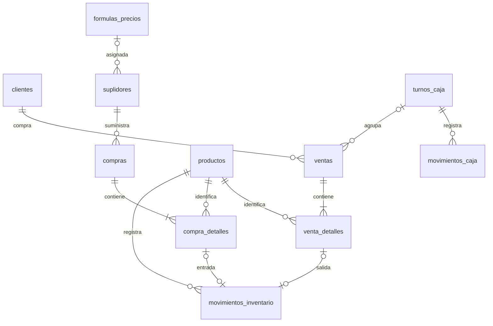

# Revisión de la base de datos — 22 de noviembre de 2026

La base del negocio sí tiene un esquema relacional. Después de activar caja, Supabase contiene **12 tablas operativas en `public`, 8 tablas internas en `pos_privado` y 49 tablas de archivo en `netpos_historico`**. La auditoría inicial encontró diez tablas operativas, sin tablas sobrantes ni índices exactamente duplicados; posteriormente se incorporaron las dos tablas de caja con autorización expresa del usuario. No se borraron tablas ni se registraron operaciones de prueba en la base real.

## Dónde ver el esquema

- En el repositorio: [`supabase/schema.sql`](../supabase/schema.sql) reúne la estructura; [`supabase/migrations/`](../supabase/migrations/) conserva los cambios ordenados. Las migraciones son el mecanismo de actualización. `schema.sql` sirve como referencia de estructura y no sustituye la inicialización ni el registro de migraciones.
- En Supabase: abre [Table Editor](https://supabase.com/dashboard/project/uzbranexwuzcwkxaifsq/editor) y selecciona `public`, `pos_privado` o `netpos_historico`. El selector de esquema cambia el grupo de tablas mostrado.
- Para localizar inventario, ventas, compras y cuentas de acceso, consulta [Dónde encontrar los datos](donde-esta-cada-dato.md).

## Qué representa cada grupo

| Grupo | Objetos comprobados en el servidor | Función |
| --- | --- | --- |
| `public` | `productos`, `clientes`, `suplidores`, `ventas`, `venta_detalles`, `compras`, `compra_detalles`, `movimientos_inventario`, `configuracion`, `formulas_precios` | Operaciones y configuración del POS actual. |
| `public` | `turnos_caja`, `movimientos_caja` | Aperturas, entradas/salidas, cierres y conciliación de efectivo. Las ventas nuevas guardan turno y medio de pago. |
| `pos_privado` | `sistema`, `solicitudes` | Identidad y revisión de la base; registro de claves para evitar operaciones duplicadas. |
| `pos_privado` | `estado`, `respaldos` | Archivo del formato anterior y copias anteriores a restauraciones. El POS actual no guarda sus operaciones como un único JSON. |
| `pos_privado` | `netpos_importaciones`, `netpos_archivos`, `netpos_catalogo`, `netpos_contactos` | Trazabilidad de importación, originales comprimidos y correspondencias con los identificadores importados. |
| `netpos_historico` | 49 tablas | Historia del sistema NetPOS. Su cantidad no equivale a duplicación del esquema operativo. |
| Supabase Auth | Cuentas administradas por Authentication | Usuarios y autenticación. No hace falta una tabla de contraseñas dentro de las tablas del negocio. |

Los identificadores de catálogo y contactos guardados en el archivo NetPOS corresponden a la generación `database_id` de la importación. No tienen una clave foránea hacia las tablas operativas actuales: una restauración puede cambiar esa generación y reutilizar números. Añadir esa relación indiscriminadamente vincularía archivos antiguos con registros nuevos.

## Relaciones del POS comprobado



El diagrama resume el comportamiento de la aplicación. Las claves foráneas protegen las referencias; la API transaccional también comprueba las sumas de documentos, movimientos de existencia y versiones. El editor de tablas no sustituye esas reglas: registra y corrige operaciones desde el POS.

## Verificaciones realizadas

Se consultaron únicamente catálogos y metadatos de Supabase dentro de transacciones `READ ONLY`; no se leyeron filas del inventario, clientes, ventas ni archivos originales.

- Las **7 migraciones** hasta `20261122020000_archivo_netpos` constaban aplicadas en Supabase.
- Antes de incorporar caja, el esquema del servidor, las siete migraciones ejecutadas en una base desechable y `schema.sql` coincidieron en **159 columnas, 146 restricciones, 35 índices, 13 políticas y 9 funciones privadas**. Se normalizaron únicamente los saltos de línea CRLF/LF al comparar funciones.
- Las 10 tablas operativas tienen RLS. No se encontró acceso efectivo a tablas del negocio para `anon`, `authenticated` o `service_role` combinando permiso de esquema y permiso de lectura/escritura.
- La credencial de ejecución del POS pertenece a `pos_app`; no tiene superusuario, omisión de RLS, creación de roles/bases, creación de objetos en `public` ni lectura del histórico y los originales NetPOS.
- Las tablas privadas del archivo NetPOS se protegen mediante revocación de permisos de esquema y tabla. La ausencia de RLS en esas cuatro tablas administrativas no implica por sí misma exposición a la aplicación.
- La comparación de índices no encontró duplicados exactos de columnas, expresiones, colaciones y predicados. No se evaluó la utilidad de cada índice mediante carga real.
- Pasaron **37 de 37 pruebas** de base, precisión, operaciones, contactos/configuración e importación NetPOS, todas sobre PostgreSQL desechable:

```powershell
node --test tests/database.test.js tests/inventory-precision.test.js tests/operations.test.js tests/contact-settings.test.js tests/netpos-import.test.js
```

## Caja aplicada en el servidor

La migración `20261122030000_caja.sql` añade `public.turnos_caja`, `public.movimientos_caja` y las columnas `ventas.caja_id` / `ventas.metodo_pago`. El respaldo pasa a versión 6 y conserva compatibilidad de restauración con versiones 2 a 5.

El usuario autorizó la migración y la actualización del POS local y web. La comprobación posterior, en una transacción `READ ONLY`, confirmó **8 migraciones aplicadas**, las dos tablas de caja, ambas columnas de ventas y RLS en las doce tablas de `public`. Los conteos detallados y las 37 pruebas anteriores corresponden al esquema previo a esa incorporación. La activación y las pruebas actuales se distinguen en el [informe de caja y cuenta](activacion-caja-cuenta-2026-11-22.md).

La restauración de caja comprueba saldos acumulados no negativos, ventas en efectivo, movimientos dentro de su turno, conciliaciones de cierre y turnos que no se superponen. Los nuevos respaldos conservan seis decimales de segundo. En respaldos anteriores con horas reducidas a milisegundos, los ingresos se consideran primero cuando coinciden las horas: permite recuperar historias válidas, pero no demuestra el orden original dentro de ese milisegundo.

## Límites y pendientes

No se recomienda eliminar tablas como resultado de esta revisión. El archivo histórico, los originales y los controles de idempotencia tienen funciones distintas. Una eventual política de retención requiere decidir qué historia y respaldos debe conservar el negocio.

La revisión confirma estructura y permisos en el momento consultado, no certifica la exactitud de todos los datos históricos. Tampoco acredita abonos, anulaciones, emisión fiscal autorizada, permisos diferenciados de dueño/cajero, sincronización sin conexión ni instalador Windows. Esas funciones requieren sus propias reglas, persistencia y pruebas.
